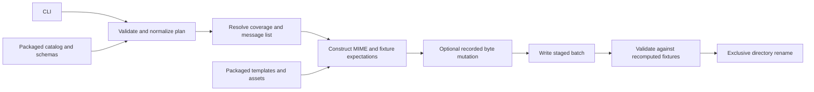

# Technical design

Astrea is an offline Python CLI that turns a JSON plan into a flat folder of
synthetic emails and expected test results. The
[specification](doc/design/specification.md) and detailed
[generation contracts](doc/design-meta/examples/contracts.md) define the target
behavior and later phases. This document describes the implementation.

## Components

| Path | Responsibility |
| --- | --- |
| `src/astrea/cli.py`, `__main__.py` | argparse commands, version, stdout/stderr, and exit codes. |
| `src/astrea/catalog.py`, `models.py` | Installed MVP metadata and resolved coverage cases. |
| `src/astrea/planning.py` | Strict plan validation, normalization, selection, deterministic allocation, dates, domains, and seed derivation. |
| `src/astrea/jsonio.py`, `errors.py` | Bounded strict JSON/file reads, canonical JSON output, and structured diagnostics. |
| `src/astrea/rendering.py` | Localized fixture construction, header profiles, MIME serialization, expectations, and resource accounting. |
| `src/astrea/mutations.py` | Recorded byte edits for malformed fixtures. |
| `src/astrea/assets.py`, `data/` | Fixed passive assets, provenance inventory, templates, catalog, and strict plan/manifest JSON schemas. |
| `src/astrea/batch.py` | Generation orchestration, manifest summaries, normal MIME inspection, and batch validation. |
| `src/astrea/storage.py` | Confined descriptor-based access, staged writes, cleanup, and exclusive publication. |
| `scripts/validate-specs.py`, `tests/test_validate_specs.py` | Independent standard-library checks for searchable specification metadata. |
| `tests/test_planning.py`, `test_runtime.py`, `test_cli.py` | Runtime contracts, end-to-end checks, and adversarial inputs. |
| `doc/design-meta/`, `doc/design/` | Authored design inputs and generated Markdown respectively. |
| `pyproject.toml`, `uv.lock`, `.python-version` | Package metadata, exact dependency resolution, and development Python pin. |
| `.gh-flarebyte.cue`, `Makefile` | Managed Python workflows and documentation commands respectively. |

The console entry point is `astrea.cli:main`. `python -m astrea` reaches the same
interface. Internal Python modules are not a separate supported library API.

## Plan to batch flow

Plan templates supply explicit starting values. Input plans must supply required
fields and exactly one domain source. JSON schemas reject unknown fields and
incorrect types, including boolean or floating-point integer fields. Semantic
checks enforce real calendar dates, chronological nonoverlapping periods, valid
`.test` domains, supported selections/profile pairs, fixture parameters, and caps.
Duplicate JSON keys are rejected before schema validation.

A relative domain-file path is resolved from the input plan's directory. The file
is read once, bounded to 64 KiB, and normalized into an ordered domain list. The
saved plan embeds that list; batch validation never follows external domain files.

The planner sorts resolved cases, allocates every case once per period, then
repeats complete groups without cutting threads. It computes inclusive UTC dates
using the specification's integer interpolation rule. Preview and generation use
the same planner. Saved message lists are checked against a fresh computation.

## Reproducible rendering

SHA-256 of consistently formatted identity data derives separate field seeds.
Identity includes the batch seed, period ID, fixture ID, locale, occurrence,
thread member, and field name. It excludes period titles and global file indices.
Domain assignments use the period-local message index and fixed role offsets.
Thread participant domains use the thread's first index.

Curated project-authored templates provide body prose; an independently seeded
Faker instance supplies each recipient name. Effective Faker name-provider locales
are recorded, including Arabic's current English-name fallback. Body templates do
not fall back to another language. Language review of the authored prose remains
a release-quality task.

Python's `email` package builds messages with an explicit SMTP policy, CRLF,
controlled wrapping, UTF-8 bodies, encoded Unicode headers/filenames, and explicit
deterministic MIME boundaries. Assets are fixed packaged bytes. Expectations are
built from the fixture's constructed message and content before output parsing;
the parser's output does not define them. Normal output is then inspected with a
separate standard-library parse, comparing headers, MIME properties, decoded
hashes, and body facts.

Repeatability applies to the same installed Python, dependencies, templates,
assets, catalog, and generator. No output contains current timestamps, host paths,
or usernames. Cross-version byte compatibility is not promised.

## Stress and resource boundaries

Core and stress cases are distinct catalog entries. Stress selection requires
explicit permission in the plan. Deep/wide and advertised filename cases remain
`stress-valid`; deliberately broken cases are `malformed`.

Malformed output starts as valid MIME. The mutation layer records nonoverlapping
edits against original offsets and applies them in descending order, preserving
original/final hashes and baseline expectations. Unreliable decoded hashes are
null for encoding/truncation cases. No mutated message is parsed and rewritten.
The CLI never invokes a parser on stress output.

Planning bounds file counts and structural settings. Rendering enforces actual
serialized bytes, header bytes, part counts, depth, attachment counts, and decoded
attachment sizes. Batch byte limits are checked while writing. JSON input reads
are bounded to 64 MiB; expanded plan and manifest output have the same per-file
UTF-8 budget, including the final newline. Period IDs are capped at 128 characters
and titles at 1024. Plans are measured before staging, manifest entries are
accounted for as they accumulate, and metadata writes stream with byte checks
before each chunk. Domain sources have their smaller dedicated cap. Validation
first compares actual message bytes with bounded deterministic fixture output,
then parses only exact normal bytes. This keeps untrusted or stress bytes away
from the in-process parser.

## Filesystem completion and validation

Output parents must exist. Output ancestry must be root/current-user owned and
not group/other writable unless sticky-bit protections apply. macOS extended
allow ACLs are conservatively rejected; absent and deny-only ACLs are allowed.
Root and same-user processes are trusted; those principals can change filesystem
state outside this protection boundary. Directory traversal opens each component with
`O_NOFOLLOW` and holds directory descriptors. Files use exclusive creation and
are flushed before completion. All output starts in a private sibling staging
directory, which is validated before publication. Staging identity is checked
immediately before rename and against the resulting destination afterward.
Observed substitutions fail without deleting another actor's replacement entry.

Publication uses `renameatx_np(RENAME_EXCL)` on macOS or
`renameat2(RENAME_NOREPLACE)` on Linux. It refuses a destination created during
generation rather than relying on an existence check. Other platforms fail
without publishing. The Linux path requires validation on a Linux host. Cleanup
checks the staging directory's identity and removes only that run's staging tree.

Batch validation requires one manifest and `batch.astrea-plan.json`. It rejects
symlinks, nonregular entries, unsafe filenames, and missing/extra emails. Reads
stay confined to the opened input directory. It recomputes the plan, message
bytes, expectations, coverage, and asset inventory and compares the supplied
manifest to those results; changing a manifest cannot authorize different paths
or remove required assertions. Validation checks consistency, not authenticity:
a coherently replaced plan and batch constitute another valid batch.

## Diagnostics and tests

Commands return 0 on success, 2 for invalid invocation/plans, and 1 for file-access
or validation failures. Diagnostics carry stable codes and optional field/limit
context. JSON diagnostics use stderr; results use stdout. Input contents and email
bodies are not included in errors.

Tests cover specification/catalog parity, strict configuration, coverage and thread
allocation, all supplied plans and profile combinations, multilingual MIME,
replay, cross-process determinism, offline generation, mutation records, limits,
tampering, unsafe paths, cleanup, and publication races. Downstream stress parsing
runs in a separate process with time and memory limits. macOS tests monitor RSS
externally; Linux tests set an address-space limit. See
[CONTRIBUTING.md](CONTRIBUTING.md) for commands.

## Specification documentation workflow

`make doc-design` runs `scripts/generate-design.sh`: metadata validation through
`gh flarebyte`, `flyb validate`, then `flyb generate markdown`. `app.cue` assembles
authored tables, prose, and examples into `doc/design/specification.md`. The
standard-library metadata validator checks CSV structure, canonical concepts,
and manifest fixture tags; it does not validate runtime schemas or email bytes.
The runtime uses packaged data independently of the checkout; tests keep its
catalog aligned with the specification tables.
